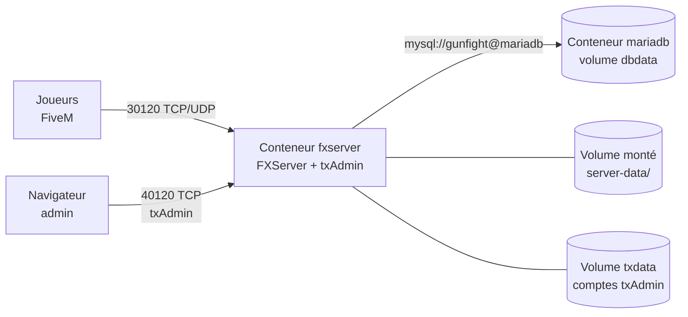

# Architecture

## Vue d'ensemble



Le serveur est un empilement de trois choses :

1. une **image Docker** qui contient uniquement FXServer (téléchargé depuis
   Cfx.re) et un script de démarrage ;
2. un dossier **`server-data/`** monté dans le conteneur : c'est là que vivent
   `server.cfg` et les ressources Lua, donc ton code, modifiable sans
   reconstruire l'image ;
3. un conteneur **MariaDB** prêt pour la phase 2 (statistiques), sans port
   exposé.

## Composants

| Fichier | Rôle |
|---|---|
| `Dockerfile` | Debian `bookworm-slim`, télécharge FXServer du canal `recommended` (ou `FX_CHANNEL`/`FX_URL`), garde l'URL dans `FX_VERSION.txt`, copie `server-data/` par défaut, expose 30120/TCP-UDP et 40120/TCP |
| `docker-compose.yml` | deux services : `fxserver` (construit localement, `env_file: .env`, volumes `./server-data` et `txdata`) et `mariadb:11.4` (volume `dbdata`, `docker/mariadb.cnf`, scripts de `docker/db/init/`) ; le serveur attend que la base soit `healthy` |
| `docker/entrypoint.sh` | valide `LICENSE_KEY`, génère `server-data/secrets.cfg` à partir de `.env` (en retirant les `\r` de Windows), puis lance FXServer |
| `server-data/server.cfg` | endpoints réseau, `exec secrets.cfg`, `sv_scriptHookAllowed 0`, ordre de démarrage des ressources, permissions admin |
| `.env.example` | modèle de configuration, copié en `.env` au premier `start.bat` |

Le fichier `secrets.cfg` est **généré**, jamais édité à la main : il contient la
clé de licence, le nombre de joueurs, le nom du serveur, la chaîne de connexion
MySQL et les identifiants administrateurs.

## Démarrage du conteneur

```text
.env ──> entrypoint.sh ──> server-data/secrets.cfg ──> FXServer
                                    │
        TXADMIN=true  (défaut)      └─> run.sh  (mode moniteur : txAdmin pilote le serveur)
        TXADMIN=false               └─> run.sh +set onesync on +exec server.cfg  (démarrage direct, CI)
```

En mode moniteur, **aucun argument** ne doit être ajouté après `run.sh` :
txAdmin plante (SIGSEGV) au démarrage. Le mode direct sert aux tests rapides et
au job Docker de la CI (`TXADMIN=false`).

## Ressources FiveM

`server-data/resources/` contient deux familles de ressources.

### Ressources Cfx.re (`[cfx-default]`)

`mapmanager`, `spawnmanager`, `baseevents` — fournies par Cfx.re, non
modifiées, démarrées avant nos ressources.

### Ressources du jeu (`[gunfight]`)

| Ressource | Responsabilité | Fichiers |
|---|---|---|
| `gf_core` | base commune : modes, apparition, armes, morts, anti-tir entre coéquipiers, multi-kills | `config.lua` (partagé), `server.lua`, `client.lua` |
| `gf_ui` | interface NUI : HUD, kill feed, dégâts, annonces, classement | `html/` (page `ui_page`), `client.lua` |
| `gf_maps` | éditeur de maps en jeu (`/editor`), liste (`/maps`), stockage `data/maps.json` | `html/`, `server.lua`, `client.lua` |
| `gf_attack` | mode Attaque de zone : deux équipes, manches, chrono | `config.lua`, `server.lua`, `client.lua` |
| `gf_redzone` | mode Redzone : zone libre, prise de véhicule, podium | `config.lua`, `server.lua`, `client.lua` |

Chaque ressource déclare ses scripts dans `fxmanifest.lua`
(`fx_version 'cerulean'`, `game 'gta5'`, `lua54 'yes'`). Les tests vérifient que
**chaque fichier déclaré existe** : un `client.lua` renommé sans mise à jour du
manifeste casse le démarrage de la ressource.

Ordre de démarrage imposé par `server.cfg` (les dépendances vont dans ce sens) :

```text
chat · mapmanager · spawnmanager · baseevents
gf_ui · gf_core · gf_maps · gf_attack · gf_redzone
```

`sessionmanager` et `hardcap` n'existent plus dans les artefacts FXServer
récents : ne pas les remettre dans `server.cfg`.

## Autorité du serveur

Le client ne décide jamais de ce qui compte :

- score, victoires et fin de manche sont calculés par `gf_core`/`gf_*` côté
  serveur ;
- les tirs sur un coéquipier ou un joueur protégé sont annulés côté serveur ;
- chaque mode a son propre **routing bucket** : lobby, Attaque et Redzone ne se
  voient pas.

Toute nouvelle fonctionnalité doit respecter cette séparation : une valeur
envoyée par le client est une *proposition*, jamais une vérité.

## Données

### `gf_maps/data/maps.json`

Fichier unique, versionné, écrit par l'éditeur en jeu. Structure :

```json
{
  "redzone": [
    {
      "id": "redzone_1795564101_8318",
      "name": "TEST",
      "radius": 103.0,
      "center": { "x": 30.58, "y": -290.08, "z": 46.77 },
      "spawns": [{ "x": -113.44, "y": -693.10, "z": 33.82, "h": 340.33 }]
    }
  ],
  "attack": [
    {
      "id": "attack_1795564397_1746",
      "name": "Parking",
      "points": [{ "x": -1036.2, "y": -2708.6, "z": 12.8 }, "…"],
      "attackSpawn": { "x": -961.6, "y": -2431.1, "z": 12.8, "h": 162.4 },
      "defenseSpawn": { "x": -1041.6, "y": -2584.0, "z": 12.6, "h": 267.9 }
    }
  ]
}
```

Les tests vérifient que les rayons sont positifs, qu'une zone d'attaque a au
moins trois sommets, que chaque map a un nom et que les identifiants sont
uniques. Une map créée en jeu peut donc être commitée telle quelle.

Tant qu'aucune map n'est cochée pour un mode, les zones de secours des
`config.lua` sont utilisées.

### Base MariaDB

Prête mais non utilisée par le jeu (phase 2, `oxmysql`) : base `gunfight`,
utilisateur `gunfight`, réglages InnoDB/`utf8mb4` dans `docker/mariadb.cnf`,
scripts de `docker/db/init/` exécutés une seule fois sur une base vide. La
chaîne `mysql_connection_string` est déjà générée dans `secrets.cfg`.

## Intégration continue

| Workflow | Déclencheur | Rôle |
|---|---|---|
| `.github/workflows/qualite.yml` | PR, envoi sur `main` | vérifications statiques + tests de cohérence (voir [`qualite.md`](qualite.md)) |
| `.github/workflows/docker.yml` | PR, envoi sur `main`, tags `v*` | construit l'image, la publie sur GHCR (hors PR), puis teste un démarrage réel des ressources |

Les deux sont déclarés **bloquants** dans la protection de `main` : voir
[`protection-branche.md`](protection-branche.md).

## Limites connues

- La logique de jeu Lua n'a **pas encore** de tests unitaires : la couverture
  automatique porte sur la syntaxe, les manifestes, la configuration et le
  démarrage réel des ressources.
- Le test de démarrage nécessite le secret `CFX_LICENSE_KEY` ; sans lui il est
  ignoré (le job de construction d'image reste bloquant).
- Le serveur tourne avec `sv_scriptHookAllowed 0` : aucune ressource cliente
  non signée n'est chargée.
- Un anti-triche dédié reste conseillé avant une ouverture au grand public.
