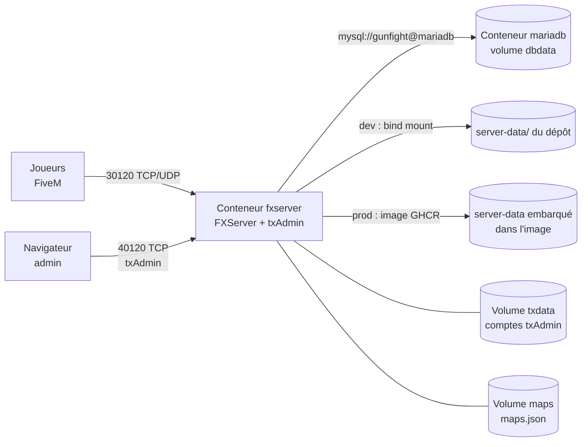

# Architecture

## Vue d'ensemble



Le serveur est un empilement de trois choses :

1. une **image Docker** qui contient FXServer (téléchargé depuis Cfx.re), un
   script de démarrage et un **`server-data/` par défaut** (copié dans
   `/opt/fivem/defaults/` et `/opt/fivem/server-data/`) ;
2. le dossier **`server-data/`** : monté depuis le dépôt en développement pour
   modifier `server.cfg` et les ressources Lua sans reconstruire l'image ; en
   production, c'est celui de l'image, et seules les maps sont un volume ;
3. un conteneur **MariaDB** prêt pour la phase 2 (statistiques), sans port
   exposé.

## Trois fichiers Compose

Le socle ne se lance **jamais seul** : il ne déclare ni `build` ni `image` pour
`fxserver`, précisément pour qu'une commande incomplète échoue au lieu de
démarrer une pile ambiguë.

| Fichier | Rôle |
|---|---|
| `docker-compose.yml` | socle commun : services `fxserver` et `mariadb`, réseau, healthchecks, plafonds mémoire, volumes `txdata` et `dbdata` (noms `gunfight_txdata` / `gunfight_dbdata`), variables communes |
| `docker-compose.dev.yml` | surcouche développement : build local (contexte `.`, argument `BUILD_SHA` avec repli `dev`) et bind mount `./server-data:/opt/fivem/server-data` ; garde les volumes du socle, donc une installation existante continue de fonctionner |
| `docker-compose.prod.yml` | surcouche production : `image: ${IMAGE_REF:?...}`, `GF_SEED_MAPS: "true"`, volume `maps` monté sur `resources/[gunfight]/gf_maps/data`, volumes renommés `gunfight-prod-*`, aucun bind mount de `server-data/` |

| Élément | Développement (socle + dev) | Production (socle + prod) |
|---|---|---|
| Image de `fxserver` | construite localement (`build:`, argument `BUILD_SHA`) | téléchargée depuis GHCR (`IMAGE_REF`) |
| `server-data/` | bind mount du dépôt | fourni par l'image, aucun bind mount |
| Maps | `server-data/resources/[gunfight]/gf_maps/data/` du dépôt | volume `maps` monté sur ce même chemin |
| `GF_SEED_MAPS` | `"false"` (les maps du dépôt sont déjà là) | `"true"` (amorce `maps.json` si le volume n'en a pas) |
| Volume txAdmin | `gunfight_txdata` | `gunfight-prod-txdata` |
| Volume MariaDB | `gunfight_dbdata` | `gunfight-prod-dbdata` |
| Volume maps | aucun | `gunfight-prod-maps` |
| Lancement | `docker compose -f docker-compose.yml -f docker-compose.dev.yml up -d --build` | `docker compose -f docker-compose.yml -f docker-compose.prod.yml pull` puis `docker compose -f docker-compose.yml -f docker-compose.prod.yml up -d` |

Les volumes de production portent des noms distincts : un `up` lancé avec le
mauvais fichier ne peut pas écrire dans la base ou les maps de l'autre
environnement. `start.bat` / `stop.bat` / `status.bat` utilisent toujours
`docker-compose.yml` + `docker-compose.dev.yml`.

## Version du build affichée par le lobby

Le badge du lobby (`BUILD <sha>`) ne code plus aucune version : il affiche le
sha court du commit **réellement construit**, et suit donc l'image déployée.

| Maillon | Fichier | Rôle |
|---|---|---|
| Calcul | `.github/workflows/docker.yml` | étape « Calculer le sha du build » dans les jobs `image` et `smoke` : `cut -c1-7` de `github.sha` |
| Construction | `Dockerfile` | `ARG BUILD_SHA=dev` puis `ENV GF_BUILD_SHA=${BUILD_SHA}` |
| Publication | `docker/entrypoint.sh` | nettoie la valeur et écrit `set gf_build_sha "<sha>"` dans `server-data/secrets.cfg` (repli `dev`) |
| Lecture | `gf_lobby/server.lua` | `GetConvar('gf_build_sha')` → `state.build` |
| Affichage | `gf_lobby/html/js/app.js` | `applyBuild(next.build)` met le badge à jour |

Le passage par la convar est volontaire : la convar est posée par l'image qui
tourne, donc le badge ne peut pas annoncer plus récent qu'elle. En production,
les ressources viennent **toujours** de l'image ; seuls `gf_maps/data` (maps),
`gf_lobby/data` (personnages), `gf_thumbs/thumbs` (photos des menus) et
`gf_vehicles/custom` (véhicule de base, customs) peuvent être des volumes ; les deux
derniers sont complétés depuis l'image au démarrage (`GF_SEED_DATA`, `cp -Rn` : rien
n'est écrasé). Monter tout `server-data`
depuis un volume (cas rencontré sur Unraid) masque les ressources de l'image :
le code servi devient une copie figée, la convar écrite par l'entrypoint est
ignorée par un ancien `gf_lobby/server.lua`, et le badge ment. La valeur n'est
lue que par le code de l'image. Hors CI (build local, FXServer lancé à la main)
la valeur est `dev`. Voir [`runbooks/deploiement-unraid.md`](runbooks/deploiement-unraid.md).

En développement, le sha local se transmet au build via l'environnement :
`BUILD_SHA=$(git rev-parse --short HEAD) docker compose -f docker-compose.yml
-f docker-compose.dev.yml build`.

## Amorçage de `maps.json`

En production, `gf_maps/data` est monté depuis le volume `maps`. Docker recopie
le contenu de l'image dans un volume nommé **neuf**, mais un volume créé vide
(volume préparé à la main, déploiement antérieur au volume) peut ne pas contenir
de `maps.json`. Après avoir généré `secrets.cfg`, `docker/entrypoint.sh` vérifie
donc `$DATA/resources/[gunfight]/gf_maps/data/maps.json`. Si `GF_SEED_MAPS=true`
et que le fichier manque, il copie le modèle de l'image depuis
`/opt/fivem/defaults/resources/[gunfight]/gf_maps/data/maps.json` et affiche
« maps.json amorcé depuis le modèle de l'image ».

- En développement, `GF_SEED_MAPS` vaut `"false"` : le dossier du dépôt est
  monté, il n'y a rien à amorcer.
- En production, l'amorçage ne remplace **jamais** un `maps.json` existant : une
  mise à jour de l'image ne touche pas aux maps créées en jeu.
- Pour repartir des maps par défaut, il faut vider le volume `maps` (après
  sauvegarde) : le prochain démarrage y recopie le contenu de l'image, donc le
  `maps.json` par défaut.

## Composants

| Fichier | Rôle |
|---|---|
| `Dockerfile` | Debian `bookworm-slim` épinglé par digest, télécharge FXServer épinglé par `.fxserver-version` (la CI passe `FX_URL` et `FX_SHA256` ; le mode `FX_CHANNEL` reste un repli local), vérifie l'empreinte, copie `server-data/` dans `/opt/fivem/server-data/` **et** dans `/opt/fivem/defaults/`, expose 30120/TCP-UDP et 40120/TCP, puis s'exécute en utilisateur non-root `fivem` (uid 10001) |
| `docker-compose.yml` | `name: gunfight` fige le préfixe des volumes du dev quel que soit le nom du dossier ; deux services : `fxserver` (sans `build` ni `image`, sans `env_file` : les secrets sont montés dans `/run/secrets`, `cap_drop: ALL`, `no-new-privileges`, volume `txdata`, healthcheck HTTP sur `30120/dynamic.json`, plafond mémoire `${FXSERVER_MEMORY_LIMIT:-4g}`) et `mariadb:11.4` épinglée par digest (volume `dbdata`, secrets `_FILE`, `docker/mariadb.cnf`, montage `docker/db/init/` (scripts exécutés seulement sur volume vide ; le schéma vient des migrations de `gf_db`), réseau interne `backend`, plafond mémoire `${MARIADB_MEMORY_LIMIT:-2g}`) ; le serveur attend que la base soit `healthy` |
| `docker-compose.dev.yml` | ajoute `build: .`, le bind mount `./server-data` et conserve l'utilisateur root pour que le montage Windows reste inscriptible |
| `docker-compose.prod.yml` | utilise `${IMAGE_REF}` par digest, monte les quatre secrets, active l'amorçage des maps et renomme les volumes en `gunfight-prod-*` |
| `docker/entrypoint.sh` | lit les secrets dans `/run/secrets` (repli sur les variables en développement), valide `LICENSE_KEY`, génère `server-data/secrets.cfg` sous `umask 077`, remet le fichier en `chmod 600`, retire les variables secrètes de l'environnement, amorce `maps.json` si demandé, puis lance FXServer |
| `server-data/server.cfg` | endpoints réseau, `exec secrets.cfg`, `sv_scriptHookAllowed 0`, ordre de démarrage des ressources, permissions admin |
| `.env.example` | modèle de configuration, copié en `.env` au premier `start.bat` |

Le fichier `secrets.cfg` est **généré**, jamais édité à la main : il contient la
clé de licence, le nombre de joueurs, le nom du serveur, la chaîne de connexion
MySQL et les identifiants administrateurs.

## Démarrage du conteneur

```text
/run/secrets/*  ──> entrypoint.sh ──> server-data/secrets.cfg ──> FXServer
   (ou .env en dev)                         │
        TXADMIN=true  (défaut)              └─> run.sh  (mode moniteur : txAdmin pilote le serveur)
        TXADMIN=false                       └─> run.sh +set onesync on +exec server.cfg  (démarrage direct, CI)
```

En mode moniteur, **aucun argument** ne doit être ajouté après `run.sh` :
txAdmin plante (SIGSEGV) au démarrage. Le mode direct sert aux tests rapides et
au job Docker de la CI (`TXADMIN=false`).

## Durcissement de l'exploitation

Le « lot 1 » du durcissement verrouille les réglages qui exposent la machine ou
les secrets. Ces invariants sont vérifiés par la classe `InfraDocker` de
`tests/test_depot.py` : les retirer fait échouer la CI.

- **txAdmin n'écoute que sur la boucle locale** : le port est publié en
  `127.0.0.1:40120:40120/tcp`, donc injoignable depuis le réseau, même sur un
  VPS. L'accès distant passe par un tunnel SSH
  (`ssh -L 40120:127.0.0.1:40120 utilisateur@IP_DU_VPS`) ou par un reverse
  proxy TLS (Caddy, nginx).
- **`secrets.cfg` reste privé** : le script tourne sous `umask 077` et le fichier
  est remis en `chmod 600` à chaque démarrage. Une mise à jour ne rend donc pas
  lisible un fichier créé en 644 par une ancienne version.
- **Healthcheck fxserver** : `curl -fsS http://127.0.0.1:30120/dynamic.json`,
  avec 120 s de `start_period` pour le démarrage à froid. En mode moniteur,
  « unhealthy » est attendu tant que l'assistant txAdmin n'est pas terminé.
- **Plafonds mémoire** : 4 Go pour `fxserver`, 2 Go pour `mariadb`,
  surchargeables par `FXSERVER_MEMORY_LIMIT` / `MARIADB_MEMORY_LIMIT` dans
  `.env` (voir `.env.example`).
- **Volumes historiques** : un volume `gunfight-prod-*` créé avant le passage
  non-root appartient à `root` et FXServer ne peut plus y écrire. La migration
  `chown -R 10001:10001` est décrite dans
  [`docs/runbooks/mise-a-jour.md`](runbooks/mise-a-jour.md).

## Ressources FiveM

`server-data/resources/` contient deux familles de ressources.

### Ressources Cfx.re (`[cfx-default]`)

`mapmanager`, `spawnmanager`, `baseevents` — fournies par Cfx.re, non
modifiées, démarrées avant nos ressources.

### Ressources du jeu (`[gunfight]`)

| Ressource | Responsabilité | Fichiers |
|---|---|---|
| `gf_core` | base commune : modes, apparition, armes (catalogue, armes possédées, choix validé côté serveur), morts, anti-tir entre coéquipiers, multi-kills | `config.lua` (partagé), `server.lua`, `client.lua` |
| `gf_killcam` | killcam : tampon des dernières secondes par joueur, clip serveur envoyé à la victime sur `gf:playerKilled`, rejeu côté client | `config.lua`, `track.lua` (partagés), `record.lua`, `replay.lua`, `server.lua` |
| `gf_ui` | interface NUI : HUD, kill feed, dégâts, annonces, classement, menu de choix des armes | `html/` (page `ui_page`), `client.lua` |
| `gf_maps` | éditeur de maps en jeu (`/editor`), liste (`/maps`), stockage `data/maps.json` ; caméra orbitale (cap et inclinaison) dans le module pur `camera.lua`, réglages dans `config.lua` | `html/`, `config.lua`, `camera.lua`, `server.lua`, `client.lua` |
| `gf_attack` | mode Attaque de zone : deux équipes, manches en 3 phases (choix des armes, placement, combat), voitures, spectateur sur les alliés | `config.lua`, `server.lua`, `client.lua` |
| `gf_redzone` | mode Redzone : zone libre, prise de véhicule, podium | `config.lua`, `server.lua`, `client.lua` |
| `gf_db` | migrations du schéma MariaDB au démarrage via `oxmysql`, sommes enregistrées dans `gf_schema_version` | `server.lua`, `migrations.lua`, `migrations/` |
| `gf_stats` | statistiques persistantes (MariaDB via `oxmysql`), export `GetPlayerStats` | `server.lua` |
| `gf_menu` | menu pause NUI (Échap) remplaçant le frontend natif : profil, règlement, Discord, déconnexion | `html/` (page `ui_page`), `config.lua`, `menu_state.lua`, `server.lua`, `client.lua` ; dépend de `gf_core` et `gf_stats` |
| `gf_admin` | panneau d'administration : joueurs, parties, outils ; ouverture par F10 ou depuis le menu Échap, données via `gf_admin:requestData`, actions réussies journalisées dans `gf_admin_log` | `html/` (page `ui_page`), `commands.lua` (liste blanche des commandes, partagé), `@oxmysql/lib/MySQL.lua`, `audit.lua` (`LogAction`), `server.lua`, `client.lua` ; dépend de `gf_core`, `gf_db` et `oxmysql` |
| `gf_screen` | écran en direct des joueurs pour les admins (`screen <id>`) : images JPEG transmises à l'admin qui regarde, cible non prévenue | `config.lua` (partagé), `server.lua`, `client.lua`, `html/` (page `ui_page`) ; dépend de `gf_core` et `gf_admin` |

Chaque ressource déclare ses scripts dans `fxmanifest.lua`
(`fx_version 'cerulean'`, `game 'gta5'`, `lua54 'yes'`). Les tests vérifient que
**chaque fichier déclaré existe** : un `client.lua` renommé sans mise à jour du
manifeste casse le démarrage de la ressource.

Ordre de démarrage imposé par `server.cfg` (les dépendances vont dans ce sens) :

```text
mapmanager · spawnmanager · baseevents
oxmysql · gf_db · gf_thumbs · gf_vehicles · gf_ui · gf_core · gf_killcam · gf_lobby · gf_maps · gf_attack · gf_redzone · gf_stats · gf_menu · gf_admin · gf_screen
```

La page NUI de `gf_screen` embarque `html/vendor/three.min.js`, une copie
vendorisée de `@citizenfx/three` version 0.100.0 sous licence MIT, dont
l'empreinte SHA-256 est
`87A89AA6EF00A49A674FD26318460F06C6452AA25A213EB529EEFC45CCBE6470`.

Les interfaces NUI sont portées par `gf_ui` (HUD, classement, choix des armes),
par `gf_menu` et par `gf_screen` (écran en direct). `gf_menu` remplace le menu
pause natif : son `client.lua`
bloque le frontend à chaque frame, ouvre `html/index.html` avec Échap et reçoit
l'état construit côté serveur à partir de `gf_stats`. Les callbacks
(`ready`, `close`, `quit`, `openAdmin`) répondent une seule fois à la page ;
`openAdmin` ferme le menu puis ouvre le panneau de `gf_admin` par l'événement
client local `gf_admin:open`. Le protocole est détaillé dans
[`menu-pause.md`](menu-pause.md).

`sessionmanager` et `hardcap` n'existent plus dans les artefacts FXServer
récents : ne pas les remettre dans `server.cfg`.

## Autorité du serveur

Le client ne décide jamais de ce qui compte :

- score, victoires et fin de manche sont calculés par `gf_core`/`gf_*` côté
  serveur ;
- les tirs sur un coéquipier ou un joueur protégé sont annulés côté serveur ;
- chaque mode a son propre **routing bucket** : lobby, Attaque et Redzone ne se
  voient pas.

Toute nouvelle fonctionnalité doit respecter cette séparation : une valeur
envoyée par le client est une *proposition*, jamais une vérité.

## Données

### `gf_maps/data/maps.json`

Fichier unique, versionné, écrit par l'éditeur en jeu. Structure :

```json
{
  "redzone": [
    {
      "id": "redzone_1795564101_8318",
      "name": "TEST",
      "radius": 103.0,
      "center": { "x": 30.58, "y": -290.08, "z": 46.77 },
      "spawns": [{ "x": -113.44, "y": -693.10, "z": 33.82, "h": 340.33 }]
    }
  ],
  "attack": [
    {
      "id": "attack_1795564397_1746",
      "name": "Parking",
      "points": [{ "x": -1036.2, "y": -2708.6, "z": 12.8 }, "…"],
      "attackSpawn": { "x": -961.6, "y": -2431.1, "z": 12.8, "h": 162.4 },
      "defenseSpawn": { "x": -1041.6, "y": -2584.0, "z": 12.6, "h": 267.9 }
    }
  ]
}
```

Les tests vérifient que les rayons sont positifs, qu'une zone d'attaque a au
moins trois sommets, que chaque map a un nom et que les identifiants sont
uniques. Une map créée en jeu peut donc être commitée telle quelle.

Tant qu'aucune map n'est cochée pour un mode, les zones de secours des
`config.lua` sont utilisées.

### Base MariaDB

Base `gunfight`, utilisateur `gunfight`, réglages InnoDB/`utf8mb4` dans
`docker/mariadb.cnf`. Le jeu utilise désormais cette base : les ressources
`oxmysql` et `gf_stats` enregistrent kills, morts, parties et victoires dans la
table `gf_stats_players`. La table `gf_admin_log` (migration `0005`) reçoit le
journal des actions d'administration réussies, écrit de façon asynchrone par
`gf_admin` via `oxmysql` lorsque `gf_db` est démarrée et prête. Les tables
sont créées et mises à jour par les migrations de `gf_db` au démarrage de
FXServer, même sur une base existante ; `gf_schema_version` y enregistre la
version et la somme de chaque migration appliquée. La chaîne
`mysql_connection_string` est générée dans `secrets.cfg`.
Les personnages du lobby sont conservés dans le volume `gf_lobby/data`
(`characters`).

### Sauvegarde et restauration

`scripts/sauvegarder.sh` utilise la surcouche prod et écrit dans
`backups/<horodatage>/` trois archives : `base.sql.gz` (dump MariaDB),
`txdata.tar.gz` (comptes et configuration txAdmin) et `maps.tar.gz` (données
`gf_maps`). Il purge les dossiers de plus de 14 jours. La restauration se fait
avec le serveur de jeu arrêté : import SQL dans `mariadb` (qui reste démarré),
puis extraction des deux archives tar dans un conteneur avec le volume
correspondant monté. Ces étapes ne sont pas automatisées ; elles doivent être
répétées sur une copie avant d'être utilisées en production.

## Intégration continue

| Workflow | Déclencheur | Rôle |
|---|---|---|
| `.github/workflows/qualite.yml` | PR, envoi sur `main` | vérifications statiques + tests de cohérence (voir [`qualite.md`](qualite.md)) |
| `.github/workflows/docker.yml` | PR, envoi sur `main`, tags `v*` | construit l'image, la publie sur GHCR (hors PR), puis teste un démarrage réel des ressources, **y compris sur les PR** |

Sur une pull request, le job `smoke` construit l'image localement (sans envoi au
registre) et la démarre ; sur `main` et les tags, il télécharge l'image publiée.
Le test utilise le secret dédié `CFX_LICENSE_KEY` : sans lui, il affiche une
note et saute le démarrage sans échouer.

Les quatre checks (`Qualité du dépôt`, `Sécurité de l'historique`,
`Construire et publier l'image`, `Vérifier le démarrage des ressources`) sont
déclarés **bloquants** par le ruleset « Protection de main » : voir
[`protection-branche.md`](protection-branche.md).

Les actions GitHub sont épinglées par SHA de commit et les images par digest
(Dockerfile, MariaDB, images de base). `.github/dependabot.yml` propose chaque
semaine les mises à jour des actions et des images ; MariaDB ≥ 11.5 est ignorée
pour garder les changements de version manuels.

## Limites connues

- La logique Lua a des tests unitaires dans `tests/lua/` : `lobby_backdrop.lua`
  couvre la géométrie du fond du lobby (plan, triangles, ligne de sol,
  hauteur du regard) ; `lobby_nui_callbacks.lua` vérifie que chaque callback
  NUI répond une fois, référence de fonction FiveM comprise ; `run.lua` couvre
  les modules purs de `gf_core` (netId, distance, véhicule, rate-limit, crédit
  des kills, confirmation de mort). `tests/test_lobby_nui.py` les lance avec
  `lua5.4` ou `lua`, et saute le test si l'interpréteur manque. La plupart de
  la logique de jeu (`gf_attack`, le reste de `gf_core`…) n'est pas couverte.
- Le test de démarrage nécessite le secret `CFX_LICENSE_KEY` ; sans lui (PR de
  fork ou de Dependabot), le job reste vert mais le démarrage n'est pas testé.
  Les autres vérifications restent bloquantes.
- Le serveur tourne avec `sv_scriptHookAllowed 0` : aucune ressource cliente
  non signée n'est chargée.
- Un anti-triche dédié reste conseillé avant une ouverture au grand public.
